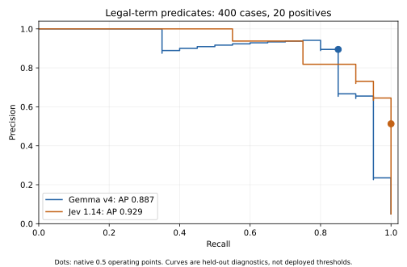

# Precision–recall operating points

This analysis incorporates the score-thresholding lesson from [Airbnb’s classifier benchmark](https://airbnb.tech/ai-ml/frontier-quality-at-1-of-the-cost-a-production-benchmark-of-llm-classifiers/). It reuses saved matched predictions; no new training or API calls are required.

Legal-term predicates: 400 cases, 20 positives. The questions cover several clause types; this pooled diagnostic is not a task-specific production threshold.

| Model | Default precision | Default recall | Default F1 | Average precision | Held-out maximum F1* |
|---|---:|---:|---:|---:|---:|
| Gemma v4 | 89.5% | 85.0% | 87.2% | 88.7% | 87.2% |
| Jev 1.14 | 51.3% | 100.0% | 67.8% | 92.9% | 85.7% |

*Maximum F1 is a descriptive upper bound obtained by inspecting this held-out set. It is optimistic and is not a deployable threshold or an independent estimate after threshold tuning.

The higher default F1 and accuracy for Gemma do not imply better ranking across operating points. Jev has higher average precision here. Its rounded returned scores create ties, which move together in the curve. Only 20 positives are present, so precision/recall estimates remain sensitive to individual cases.

## Deployment protocol

1. Define a stable task, label policy, and acceptable false-positive/false-negative tradeoff.
2. Collect separate calibration predictions with explicit task keys and split labels.
3. Fit each task threshold on calibration data with `fit_threshold`; freeze the model, score calibrator, data fingerprint, and threshold together.
4. Apply it unchanged to an independent evaluation set with `evaluate_frozen_threshold`.
5. Use production sample weights only when their sampling probabilities are known; do not infer traffic weights from this benchmark.

No threshold or served model changed as a result of this diagnostic.
